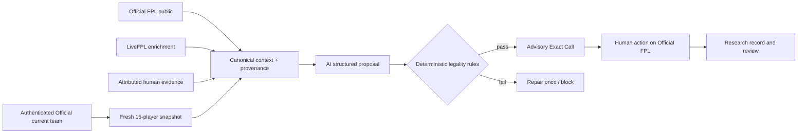

# Architecture and application map

## Distinguish these names

| Name | Responsibility | Where it lives |
|---|---|---|
| FPL Decision Engine | Complete decision-support product | Windows-local integrated architecture |
| Control Center | Local dashboard and operational UI | PowerShell HTTP service + browser HTML/JS |
| Decision Studio | AI decision feature | Inside Control Center |
| FPL Decision Engine Studio | Documentation, reports, evidence handoff | Separate private ChatGPT plugin |
| V5 Event Console | Independent event/public-feed monitoring | Separate Python service; not authenticated team authority |

## Trust and dataflow

**Authority:** Official FPL data owns player IDs, fixtures, locked team and event-live scoring; authenticated Official private data owns current editable team and related economics. LiveFPL adds projected rank, effective ownership and supplementary context, **not** official live points. Opinions and model text never override authenticated state.

## Implementation boundaries

The inspected historical V4.1.2 code includes PowerShell server/orchestration, an HTML/JavaScript Control Center, JSON/JSONL snapshots, rule validation and league/research modules. Named modules include `Start-ControlCenter.ps1`, `Run-Sync.ps1`, `Sync-FPLAccount.ps1`, `Resolve-CurrentTeam.ps1`, `Run-CopilotAI.ps1`, `Sync-LeagueIntelligence.ps1`, `Sync-ManagerIntelligence.ps1` and `Close-Gameweek.ps1`. Later private V5 work and a Python event console are documented historically, but are not mirrored wholesale here.

### Candidate discovery versus prediction

The documented shortlist heuristic is `2 × ep_next + 0.8 × form + 1.3 × xGI_per90`. It is used for **candidate discovery**, not a validated points prediction nor the final transfer objective.

### Deterministic rules

A valid proposal must use owned transfer-out and non-owned transfer-in players, maintain position and budget, retain 15 unique players and no more than three per club; 11 starters must form a legal formation (1 GK, 3–5 DEF, 2–5 MID, 1–3 FWD); bench and captain/vice must be valid.

## Fail-closed principle

Healthy public feeds do not establish an authenticated editable squad. When current-team authentication is rejected/expired, prior cached data may support historical analysis, **not** a current actionable Exact Call.

## Evidence status

The most recent explicit private auth closure did not succeed. The disabled five-minute caretaker and incomplete long-running reliability tests cannot be described as shipped certification. The public source represents a historical inspected subset.

[Decision method](../DECISION_ENGINE.md) · [Blueprint](../TECHNICAL_BLUEPRINT.md) · [Release gates](../RELEASE_READINESS.md)