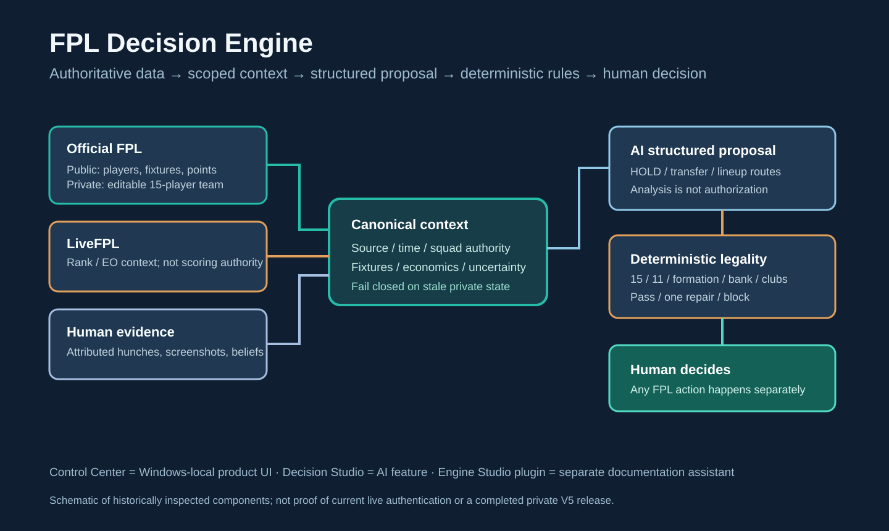

# FPL Decision Engine — presentation & research guide

**For sports analytics, product/BI, engineering and research audiences.** Public-safe companion to the curated V4.1.2 source showcase, updated October 2026. These pages describe historical implementation and research direction, **not a live operational certification**.

## Start by audience

| Audience | Read | What it explains |
|---|---|---|
| Recruiter / nontechnical product lead | [Presentation story](PRESENTATION_STORY.md) | The problem, outcomes and five-minute narrative |
| Developer / sports engineer | [Architecture & application map](ARCHITECTURE_MAP.md) | Components, authority, control boundaries |
| App demo / user onboarding | [Operator walkthrough](OPERATOR_WALKTHROUGH.md) | Features, source status, safe demo steps |
| Researcher or PhD supervisor | [Research protocol & evidence](RESEARCH_BRIEF.md) | Testable questions, observational limits and methods |
| Interview / career reviewer | [Build story & technical Q&A](BUILD_STORY_AND_QA.md) | AI-assisted development, systems design and honest answers |

## Project identity

**Decision Engine** is the whole local-first FPL decision-support product. **Control Center** is the browser UI and Windows-local operational app. **Decision Studio** is its AI-assisted recommendation workflow. **FPL Decision Engine Studio**, a separate private ChatGPT plugin, only helps maintain documentation, evidence and handoffs; it does **not** operate the Windows services or private FPL account. A separate Python V5 event console has an auxiliary monitoring role.

## The one-sentence model

**Official data establishes state. Football and competitive evidence informs options. AI proposes. Deterministic code validates. The human makes any real Official FPL changes.**

The published `src/` is a curated historical V4.1.2 source subset, not the full private V5 Windows runtime. The most recent private auth recovery evidence did **not** establish a fresh editable squad; continuous uptime, better rank and causal AI impact are unproven.

## Privacy, provenance and licensing

These public pages contain **no** credentials, current personal account data, raw manager or rival research, private screenshots, Windows-local exports or authentic proposal records. Private historic logs and 8-chapter dossier are deliberately excluded. The repo does not currently include a selected open-source license; do not infer unrestricted software reuse.

For independently viewable underlying sources see [README](../../README.md), [Architecture](../ARCHITECTURE.md), [Decision Engine](../DECISION_ENGINE.md), [Release readiness](../RELEASE_READINESS.md) and [Calibration](../CALIBRATION_AND_OUTCOMES.md).

**Presentation-ready PDF and PPTX exports have been prepared separately.** They will be added to GitHub only through a reviewed binary-upload process; this Markdown set is the fully reviewable public counterpart.